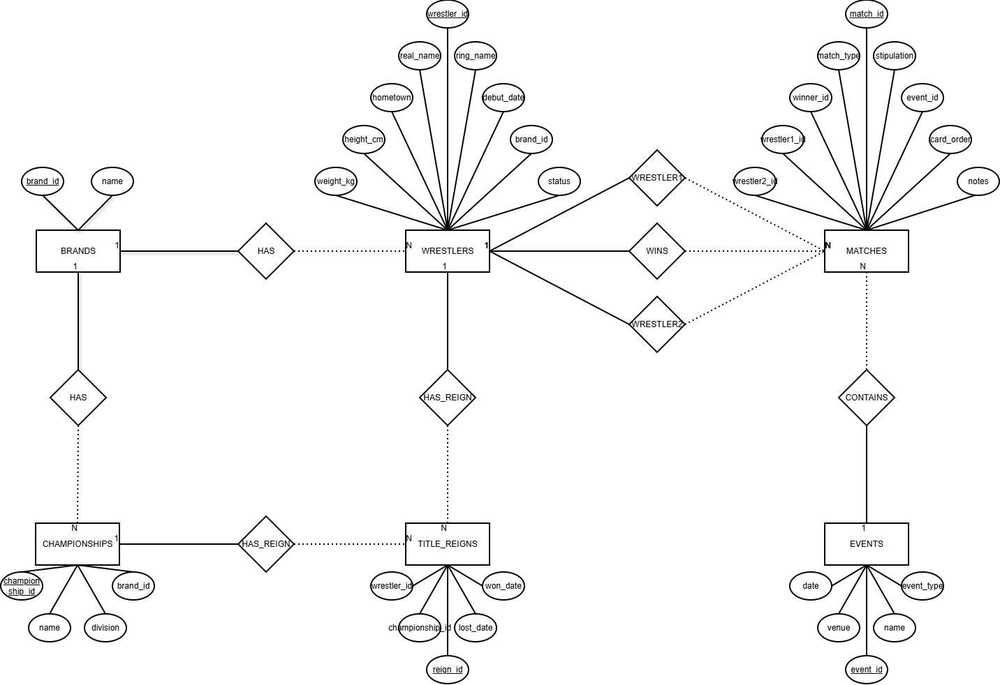

# Design Documents

## DDT-Database

By Aiman (edX/GitHub: aimanfazal)

Video overview: <URL HERE>

## Scope

This database captures the core of WWE: wrestlers, brands, championships, events, and matches. You can pull up any wrestler’s profile—find out what brand they’re on, if they’re still active, check out their title runs, see the card for an event, read match results, or break down win/loss stats.

The focus stays on the three main shows: Raw, SmackDown, and NXT. It tracks their rosters, their titles, and keeps a record of championship history, every WWE event, and all matches.

It leaves out staff working backstage, merch, finances, ticket sales, crowd sizes, and anything about TV or pay-per-view ratings.

## Functional Requirements

Here's what you can do with this database:

- Look up details for any wrestler—their brand and current status too.
- Check out full title histories and see who holds each championship right now.
- Browse through all matches from an event and get their results.
- Quickly check a wrestler’s win/loss record.

It’s designed for record-keeping, not booking future matches.

## Representation

### Entities

There are six tables in the database:

**brands:** Holds info on each WWE brand with a `brand_id` and `name`. Wrestlers and championships link back to a brand.

**wrestlers:** Stores each wrestler’s ring name, real name, measurements, hometown, debut date, status, and associated brand.

**championships:** Lists all titles, their divisions, and which brand they belong to.

**title_reigns:** Tracks championship history—who won, when they won, and when (or if) they lost the belt. If `lost_date` is `NULL`, the reign’s ongoing.

**events:** Captures WWE events by `name`, `date`, `venue`, and event type.

**matches:** Stores every match, links it to an event, lists the wrestlers, the match type, any stipulation, where it was on the card, participants, winner, and any notes. It’s set up for two participants directly; bigger matches get explained in the `notes` field.

## Relationships

I mapped out the ER diagram in draw.io, using the schema to lay out the tables and connections.

- `brands` connects one-to-many with wrestlers and championships—a single brand can have lots of wrestlers and multiple titles.
- `title_reigns` links wrestlers and championships, letting you track a long history of title changes.
- `events` connect one-to-many with matches since an event features several matches.
- `matches` references wrestlers three ways: wrestler1_id, wrestler2_id, and winner_id.

## Optimizations

I added indexes to columns that come up the most in searches and joins—stuff like wrestler names, brand, title histories, event IDs, and dates.

There's a `current_champions` view that makes it a snap to see who holds each title by selecting only those reigns where `lost_date` is still `NULL`.

## Limitations

The `matches` table only gives structured fields for two wrestlers. If there are more in a match, I describe them in the notes. You won’t be able to search for everyone in multi-person matches directly.

Another limitation is handling ongoing title reigns. If a reign is still active, `lost_date` is `NULL`. The accuracy depends on updating the data as soon as a title changes hands.

Tag-team titles are tricky too—since `title_reigns` stores just one wrestler per reign, you can't capture an entire tag team holding belts as a unit. That kind of nuance gets lost in the current setup.